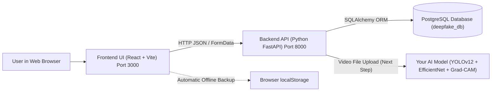

# Deepfake Detective — Complete Project & Model Integration Guide

This guide explains **everything** in your project in simple, clear steps: what every folder and file is, how the React frontend works, how the Python FastAPI + PostgreSQL backend works, how they talk to each other, and **exactly how to plug in your real trained AI model**.

---

## 1. The Big Picture: How Your Project Is Organized

Your project is a **Full-Stack Web Application** split into two main parts inside `front-end/`:

1. **Frontend (`project/` folder)** — What the user sees and clicks in the browser. Built with **React 19**, **TypeScript**, **Vite**, and **Tailwind CSS**. Runs on `http://localhost:3000`.
2. **Backend (`backend/` folder)** — The server and database brain. Built with **Python FastAPI** and **PostgreSQL** (via SQLAlchemy). Runs on `http://127.0.0.1:8000`.



> **Why does your website still work even when Python/PostgreSQL is turned off?**
> Your frontend has a smart "Dual-Mode Bridge" inside `project/src/services/db.ts`. Every time you log in, save a scan, or send a contact message, it tries FastAPI (`Port 8000`) first. If FastAPI is not running, it automatically saves to the browser's `localStorage` so your demo never crashes during an evaluation!

---

## 2. Folder & File Map (What Every File Does)

### A. Root Workspace (`front-end/`)
| File / Folder | What It Is |
| :--- | :--- |
| `package.json` | Shortcut scripts so running `npm run dev` in the root automatically starts `project/`. |
| `vercel.json` | Cloud deployment rules telling Vercel to build `project/` and host `project/dist`. |
| `project/` | Complete React + TypeScript Frontend application. |
| `backend/` | Complete Python FastAPI server + PostgreSQL database setup. |

### B. Frontend Files (`project/`)
| File | Role in Plain English |
| :--- | :--- |
| `project/index.html` | The single HTML shell loaded by the browser; mounts React inside `<div id="root">`. |
| `project/vite.config.ts` | Vite bundler settings and code-splitting chunks (`vendor-react`, `vendor-docx`, `vendor-icons`). |
| `project/src/main.tsx` | Entry point that boots up React and renders `<App />`. |
| `project/src/index.css` | Global dark cyber theme, glassmorphism styles, laser scan lines, and smooth animations. |
| `project/src/App.tsx` | **Master Controller** — connects all 8 page sections, popups, user login state, and analysis state. |
| `project/src/types/index.ts` | TypeScript data blueprints (`User`, `FrameAnalysis`, `AnalysisResult`, `ContactSubmission`). |
| `project/src/services/db.ts` | **Connection Bridge** — sends `fetch()` requests to FastAPI (`http://127.0.0.1:8000/api`) with `localStorage` fallback. |
| `project/src/services/deepfakeModel.ts` | **Analysis Engine** — currently runs the 5-step milestone simulation; this is where your real API call goes! |
| `project/src/services/docxGenerator.ts` | Generates the downloadable `.docx` Word Milestone Defense Report in the browser. |

### C. Backend Files (`backend/`)
| File | Role in Plain English |
| :--- | :--- |
| `backend/.env` | Secret configuration: PostgreSQL URL (`DATABASE_URL`), port `8000`, and allowed frontend URLs (`CORS_ORIGINS`). |
| `backend/database.py` | Connects Python to PostgreSQL using SQLAlchemy and provides database sessions (`get_db`). |
| `backend/models.py` | Defines the 3 PostgreSQL database tables: `users`, `analysis_results`, and `contact_submissions`. |
| `backend/schemas.py` | Pydantic rules that validate incoming JSON from React and format outgoing JSON responses. |
| `backend/seed.py` | Creates the PostgreSQL tables and inserts the 3 default accounts (Muhammad Adnan, Hadia Noor, Syeda Kainat Zahra). |
| `backend/main.py` | **Main FastAPI Server** — defines all `/api/...` endpoints (Health, Register, Login, History, Contact). |
| `backend/run.py` | Starts the FastAPI server using Uvicorn on `http://127.0.0.1:8000`. |
| `backend/start.bat` | One-click Windows script that activates `venv`, runs `seed.py`, and launches `run.py`. |

---

## 3. How the Frontend Components Work Together

`project/src/App.tsx` is the parent component. It holds the main state variables and passes them down as **props** to child components:

* `currentUser` — Who is currently signed in (`null` if logged out).
* `isAnalyzing` & `analysisProgress` — Tracks whether a video is currently being scanned and what percentage (`0%` to `100%`) it is on.
* `currentResult` — Holds the finished `AnalysisResult` object. When this is `null`, Section 5 is hidden; as soon as a scan finishes, Section 5 appears and the page scrolls to it!
* `historyList` — List of past video scans loaded from PostgreSQL / `localStorage`.

### Component-by-Component Cheat Sheet (`project/src/components/`)
1. **`FuturisticBackground.tsx`**: Draws the subtle animated constellation particles and mouse glow behind the whole page using HTML5 `<canvas>`.
2. **`Logo.tsx`**: Reusable Deepfake Detective shield logo with the pulsing green "active engine" dot.
3. **`Navbar.tsx`**: Sticky top header. Highlights your current section as you scroll, opens `AuthModal` when logged out, or shows your profile menu (**Scan History** & **Sign Out**) when logged in.
4. **`HeroSection.tsx`**: Top banner with `"Know what's real. See why it's fake."` and an interactive preview card letting visitors toggle between `YOLOv12 BBox`, `Grad-CAM`, and `Raw Frame`.
5. **`ModelWorkflowSection.tsx`**: Interactive 5-step diagram (`Upload video` -> `Extract frames` -> `YOLOv12 face detect` -> `EfficientNet + attention` -> `Grad-CAM + score`). Clicking any step updates the technical inspector card below it.
6. **`UploadSection.tsx`**: **Security-gated video uploader**.
   * If `currentUser` is `null`, it locks the dropzone and prompts the user to Sign In.
   * Once signed in, it checks that the file is `.mp4/.mov/.avi/.webm` and `<= 100 MB` (or lets evaluators click **Deepfake Sample** / **Authentic Sample**).
   * Clicking **Analyze Video** calls `handleStartAnalysis(file)` inside `App.tsx`.
7. **`AnalysisResultSection.tsx`**: Displays the forensic output:
   * Circular SVG confidence meter (`DEEPFAKE` in red vs. `AUTHENTIC` in green).
   * Frame-by-frame bar chart scrubber (clicking any bar selects that frame).
   * 5 keyframe cards with toggleable **Grad-CAM Heatmap**, **YOLOv12 Bounding Box**, and **Zoom Modal**, plus `.txt` report export.
8. **`WhyDifferentSection.tsx`**, **`ContactSection.tsx`**, & **`Footer.tsx`**: Present academic differentiators, save examiner feedback to PostgreSQL, and provide footer navigation.

---

## 4. How the Backend & PostgreSQL Database Work

### Database Tables (`backend/models.py`)
1. **`users`**: Stores `id`, `name`, `email`, `role`, `institution`, `avatar_url`, `password_hash`, and `created_at`.
2. **`analysis_results`**: Stores `id`, `user_id`, `file_name`, `file_size_mb`, `verdict`, `confidence_score`, `overall_fake_probability`, `frames` (JSON array of frame probabilities/bboxes/Grad-CAM regions), and `summary_note`.
3. **`contact_submissions`**: Stores `id`, `name`, `email`, `message`, and `submitted_at`.

### Backend API Endpoints (`backend/main.py`)
| HTTP Method & Route | Called By Frontend Function | What It Does in PostgreSQL |
| :--- | :--- | :--- |
| `GET /api/health` | `DatabaseService.checkBackendHealth()` | Verifies PostgreSQL is reachable. |
| `POST /api/auth/register` | `DatabaseService.registerUser()` | Hashes password with `bcrypt` and inserts a new row into `users`. |
| `POST /api/auth/login` | `DatabaseService.loginUser()` | Checks email & password hash in `users` and returns user profile. |
| `GET /api/history` | `DatabaseService.fetchHistoryFromBackend()` | Returns the latest 50 video scan records from `analysis_results`. |
| `POST /api/history` | `DatabaseService.saveAnalysis()` | Saves a completed `AnalysisResult` into `analysis_results`. |
| `DELETE /api/history` | `DatabaseService.clearHistory()` | Clears saved scan history when clicking "Clear History" in the drawer. |
| `POST /api/contact` | `DatabaseService.saveContactMessage()` | Saves contact form feedback into `contact_submissions`. |

---

## 5. How to Implement Your Real AI Model Into This Project

For your **40% Milestone**, `project/src/services/deepfakeModel.ts` simulates the 5 stages in JavaScript. Because **PyTorch (`torch`), OpenCV (`cv2`), YOLOv12, and EfficientNet** run in **Python**, your real model plugs into `backend/` via a single `POST /api/analyze` endpoint — **without needing to redesign a single React UI component**!

### Step 1: Add ML Libraries to `backend/requirements.txt`
```txt
python-multipart>=0.0.9
opencv-python-headless>=4.10.0
torch>=2.4.0
torchvision>=0.19.0
ultralytics>=8.3.0
numpy>=1.26.0
pillow>=10.4.0
```

### Step 2: Create `backend/inference.py`
Put your trained weights (e.g., `backend/weights/yolov12_face.pt` and `backend/weights/efficientnet_b4_deepfake.pth`) in `backend/weights/`, load them once at startup, extract frames with `cv2.VideoCapture`, encode each sampled frame to Base64 (`data:image/jpeg;base64,...`) in `sampleImage`, and return the dictionary matching `AnalysisResultOut` (full template in the Antigravity Architecture Guide artifact).

### Step 3: Add `POST /api/analyze` in `backend/main.py`
Accept `file: UploadFile = File(...)`, save it to a temporary file, pass the path to `analyze_video_file()`, and return the JSON response.

### Step 4: Call `POST /api/analyze` from `project/src/services/deepfakeModel.ts`
Upload the `File` using `FormData` to `fetch(`${API_BASE_URL}/analyze`, { method: 'POST', body: formData })`. When FastAPI returns the JSON, `AnalysisResultSection.tsx` will automatically display your **real extracted video frames**, **YOLOv12 bounding boxes**, **Grad-CAM heatmaps**, and **confidence scores**!

---

## 6. Quick-Start Cheat Sheet: Running Everything Locally

### Terminal 1 — Start Backend (Port 8000)
```powershell
cd backend
python -m venv venv
.\venv\Scripts\activate
pip install -r requirements.txt
python seed.py
python run.py
```

### Terminal 2 — Start Frontend (Port 3000)
```powershell
npm run dev
```

